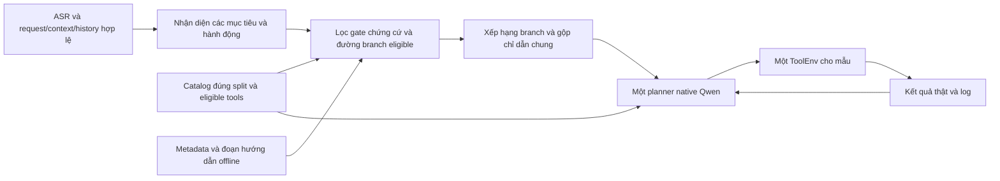

# Đề xuất retrieval skill nhẹ, offline

Ngày phân tích: 10/11/2026. Đây là thiết kế để review, **chưa triển khai**. Nguồn là [181 tool](tool-catalog-inventory.md), [16 miền nghiệp vụ + SC01](business-domains.md), [37 họ workflow](workflow-analysis.md) và [24 nhóm skill / 80 nhánh nhiệm vụ](candidate-skills.md). Không sửa prompt, NativePlanner, KV cache, ToolEnv hoặc cấu hình trong thay đổi này.

Review từ `dfbaa0416a45c25e402c98594ea63f5c220f8042`. Đơn vị xếp hạng và lấy hướng dẫn là **branch_id**, không phải domain_id hoặc toàn skill cha. Chỉ 76 nhánh E/S là ứng viên cho bước review tiếp; 4 nhánh H (S15.B01/B02, S23.B01/B02) bị loại khỏi retrieval runtime dự kiến cho tới khi xác minh. Chưa có nhánh nào được triển khai hoặc duyệt chạy thực.

## Kiến trúc khuyến nghị

Giữ một planner tổng quát theo [ADR 008](../adr/008-single-general-planner-for-mvp.md). Skill là hướng dẫn ngắn cho một mục tiêu hoặc nhánh nhiệm vụ, không phải agent chuyên miền, tool mới, script tự chạy hay một chuỗi tool bắt buộc. Retriever chỉ chọn hướng dẫn để planner tham khảo; planner vẫn quyết định từng call dựa trên kết quả thật của ToolEnv.

Đề xuất luồng tương lai:



Mũi tên C→G phải giữ **toàn bộ eligible tools**. Retrieval không thay thế eligibility, không xoá tool có điểm thấp, không thêm tool chỉ tồn tại ở split khác. Quy tắc nguồn: dùng đúng danh sách `context.installed_apps[app].tools` và `sys.ask_missing_info`, không mặc định mở toàn bộ tool của app. Xem [dataset.py](../../python/src/lifemate/dataset.py), [runtime.py](../../python/src/lifemate/runtime.py) và [executor.py](../../tools/test/executor.py).

## Metadata đề nghị cho mỗi nhánh skill

| Trường | Nội dung đề xuất | Vai trò |
| --- | --- | --- |
| `skill_id`, `version` | ID S01–S24, phiên bản nội dung | Định danh, tái lập và tránh chèn lặp |
| `branch_id`, `branch_key` | ID ổn định như S11.B02/subscription-cancel hoặc S18.B03/podcast-play | Đơn vị retrieval; không gộp lại cả skill cha sau xếp hạng |
| `domain_ids` | D01–D16 theo nhánh; SC01 nằm riêng ở system_capabilities | Chỉ là metadata phụ trợ, không phải cổng lọc top-1 miền |
| `system_capabilities`, `common_refs` | SC01 và C01–C06 thực sự cần | Chèn hướng dẫn dùng chung một lần; không tính thêm skill/branch |
| `intent_keywords_vi` | Từ/cụm cùng nghĩa, có dấu và dạng chuẩn hoá | Bắt tín hiệu từ lời nói và ASR |
| `action_keywords` | Bật, tắt, sửa, huỷ, gửi, đặt, nếu… | Phân biệt hành động trên cùng đối tượng |
| `action_groups` | Mọi nhóm AND; mỗi nhóm có một tên hoặc lựa chọn OR | Đường action của nhánh, không phải hợp tool skill cha |
| `dependencies` | Tool nguồn, trường dữ liệu, guard always/needs_data/on_user_intent và thứ tự cạnh | Phân biệt reader có điều kiện với hành động phụ như checkout; tv.guide có guard always trước tune |
| `parameters`, `guards`, `completion` | Tham số/schema tham chiếu inventory; điều kiện kích hoạt/hoàn tất của từng nhánh | Không tự nâng optional thành required hoặc đoán hành động sau khi đọc |
| `goal_tags`, `exclusions`, `owner_key` | Hành động/đối tượng; ý định không thuộc nhánh; chủ sở hữu action trong cùng mục tiêu | Tách huỷ gói khỏi đổi điểm, nghe khỏi queue; tránh gửi/checkout trùng |
| `evidence` | JSON Pointer, split, workflow ID, mã app | Không nhận tool/đối số ngoài catalog |
| `dependency_level` | E/S/H của workflow hoặc cạnh | Chặn đưa giả thuyết chưa review vào thư viện được duyệt |
| `instruction_fragment` | Tiền điều kiện, cách lấy ID, điểm rẽ, completion và missing | Hướng dẫn ngắn theo nhánh, không chép toàn schema |
| `token_cost` | Đếm bằng tokenizer checkpoint khi đóng gói | Giới hạn overhead trước khi gọi model |
| `catalog_fingerprint` | Split, schema version, hash nội dung catalog | Phát hiện nội dung skill lỗi thời |

Đây là hợp đồng dữ liệu dự kiến, không phải file cấu hình đã tạo. [80 nhánh](candidate-skills.md) đã có trigger, action groups, dependency, điều kiện, completion và tham số trích catalog. Không còn dùng hợp tool của skill cha làm điều kiện eligibility. Một đường hợp lệ khi mỗi nhóm action có lựa chọn eligible, và mọi dependency cần ở request này có nguồn dữ kiện hợp lệ hoặc tool nguồn eligible. Reader không eligible vẫn cho phép đường action nếu ID/thông tin đã có, trừ guard always như tv.guide. Ngược lại, không bịa ID khi thiếu cả dữ kiện lẫn tool nguồn; SC01 không hợp pháp hoá một tool bị cấm. Optional action checkout chỉ được đưa vào đường khi người dùng muốn đặt toàn giỏ. Việc một đường khả dụng không chứng minh mọi nhánh cùng skill đều khả dụng.

## Lựa chọn baseline: từ khoá, tên tool và luật nhỏ

Với 80 nhánh được mô tả (76 E/S để review tiếp), có thể đề xuất quét tuyến tính metadata offline trên CPU; chưa đo chi phí. Skill cha chỉ dùng điều hướng tài liệu, không là bản ghi để lấy nguyên khối. Không cần vector database, external API hoặc model bổ sung.

1. Chuẩn hoá một **bản sao để tìm kiếm**: Unicode NFC, chữ thường, khoảng trắng, thêm dạng bỏ dấu. Giữ nguyên request gốc, số điện thoại, ID và đối số. Không thay toàn bộ “đặt”/“đắt” bằng một nghĩa sau bỏ dấu.
2. Lấy request ASR cuối làm tín hiệu chính. Dùng history liên quan để giải tham chiếu (“dời cái đó”, “gửi cho người ấy”), không lấy mọi call cũ thành hành động cần lặp. Context/profile/timezone hỗ trợ xác định dữ kiện, không tự tạo ý định mới.
3. Nhận nhiều nhãn miền và hành động cùng lúc. “Xem lịch rồi nhắn” kích hoạt lịch và liên lạc; “dịch rồi gửi” kích hoạt ngôn ngữ và liên lạc. “Nếu” giữ điều kiện thay vì biến thành lệnh ghi vô điều kiện. Đối chiếu enum/context khi từ khoá mơ hồ.
4. Kiểm đường tool hợp lệ của từng nhánh. Dùng tên tool được người dùng nêu rõ hoặc tool đã xuất hiện trong history liên quan làm tín hiệu bổ sung, không lấy tên của **mọi eligible tool** như bằng chứng ý định.
5. Xếp hạng **từng branch_id theo từng mục tiêu** sau khi lọc gate H và eligibility; không gộp ngược thành toàn skill ID. Chọn nhánh phủ đúng hành động/đối tượng của mục tiêu, hợp nhất C01–C06 theo reference và xoá đoạn trùng. Giữ nguyên bản đầy đủ các schema native tool.

Công thức thử nghiệm ban đầu (trọng số là giả thuyết để kiểm trên Train Validation, không phải kết quả tối ưu):

```text
score(branch) = 8 * exact_tool_mention
              + 5 * specific_intent_phrase
              + 3 * matching_action_and_object
              + 2 * matching_domain
              + 1 * relevant_history_reference
              + 1 * asr_fuzzy_phrase_support
              - 4 * incompatible_action
```

Các tín hiệu nên là cờ hoặc tần suất có chặn để câu dài không thắng nhờ lặp từ. Đồng hạng theo `skill_id, branch_id` cố định. Eligibility là điều kiện xét đường đáp ứng, không phải điểm thưởng áp đều. Không dùng label, tool call gold, kết quả tương lai hoặc state ẩn làm đặc trưng. Không tạo rule theo sample ID hoặc nội dung test cụ thể.

Không lấy điểm matching miền làm căn cứ độc lập để chèn cả nhóm nhánh; cần có hành động + đối tượng hoặc tham chiếu hội thoại phù hợp. Các tín hiệu fuzzy chỉ hỗ trợ sinh ứng viên, không làm điều kiện mua/huỷ/gửi trở nên chắc chắn.

### Chịu lỗi ASR mà không sửa đối số theo phỏng đoán

Baseline giữ hai kênh có dấu và bỏ dấu; so cụm từ theo token, alias thao tác do người review duyệt (hủy/huỷ, check-in/làm thủ tục, playlist/danh sách phát). Có thể thêm character n-gram 3–5 và edit distance giới hạn trên từ/cụm intent khi kênh chính bỏ sót. Trọng số và ngưỡng fuzzy cần đo trên Train Validation, không tạo bảng sửa theo nội dung public/private test.

Không fuzzy sửa số tiền, chữ số ngày giờ, số điện thoại, ID, mã cổ phiếu, enum hoặc tên người thành giá trị khác. Không gộp thuốc/học/thói quen chỉ vì gần chủ đề. Giữ phủ định, điều kiện và phạm vi từng mệnh đề: “không huỷ gói, chỉ xem” không chọn S11.B02; “đừng gửi, chỉ dịch” không chọn S24. ASR làm mất dấu hoặc lẫn “huỷ” với hành động khác thì giảm độ chắc, không kích hoạt write từ một từ fuzzy đơn lẻ; không có acoustic confidence thì không tự tạo giá trị confidence. Một yêu cầu nhiều mệnh đề phải giữ phủ định theo mệnh đề, không chặn mọi hành động chỉ vì có một từ “không”.

Khi nhiều nhánh khác hành động cùng điểm mà request chưa phân biệt, không mặc định chọn write đầu tiên. Có thể chèn 0 hướng dẫn và để planner đối chiếu request/schema; nếu thực sự thiếu tham số bắt buộc của một tool đã xác định mới áp C02/SC01. Không dựng action “ask_intent” ngoài catalog.

Ví dụ minh hoạ do phân tích catalog, không trích sample:

| Request minh hoạ | Nhánh có thể chọn | Hướng dẫn phải loại |
| --- | --- | --- |
| “Huỷ gói xem phim đó” | S11.B02 | S11.B01 đổi điểm; mọi nhánh media dù cùng dịch vụ |
| “Huy goi xem phim” (ASR thiếu dấu) | Candidate S11.B02 nếu có ngữ cảnh/hành động đủ rõ | Không suy subscription_id từ fuzzy text |
| “Huỷ vé bay đã đặt” | S13.B02 | S13.B01 đặt mới và nhánh tàu/xe |
| “Nghe tập podcast đó” | S18.B03 | S18.B05 subscribe, S18.B06 queue, S18.B07 TV |
| “Ghi đã học 30 phút rồi mở playlist” | S19.B07 + S18.B01 | Ghi thuốc/habit; không lấy nguyên S19/S18 |
| “Xem lịch ngày mai rồi nhắn mẹ” | S21.B01 nếu SMS eligible + C05 | Không thêm S06.B02 thành lần gửi thứ hai |
| “Dịch rồi gửi vào nhóm” | S24.B02 + C05 | Không thêm nhánh gửi email/SMS |
| “Chỉ xem giá vàng” | 0 nhánh, dùng tool schema | Không thêm nhánh giao dịch tài chính |
| “Xem công thức rồi mua phần thiếu” | Nhận diện S15.B02 trong báo cáo để review | Gate H loại khỏi retrieval runtime; không đổi nhãn thành E vì tool thành phần có thật |

## Chọn nhiều miền và ngân sách

Mốc thí nghiệm: thường 2–4 đoạn nhánh, không phải hard cap cắt mất mục tiêu thứ năm; tổng hướng dẫn khoảng **600–1.000 token**, sau khi chừa đủ toàn bộ prompt/schema/history và output trong giới hạn context thực tế (tối đa 16.384 theo brief). Đây là ngân sách dự kiến, chưa đo trên tokenizer/model thực. Không chèn cả 24 mục Markdown hay toàn bộ inventory.

Chọn theo độ bao phủ **mục tiêu**, không theo quota miền: một mục tiêu có thể cần nhiều miền và hai mục tiêu cùng miền có thể cần hai nhánh. Với “huỷ gói rồi mở nhạc”, chọn S11.B02 + S18.B01, không lấy đổi điểm hay mọi nhánh D12. Giữ quan hệ “rồi”, “nếu”, “chỉ” ở mức mục tiêu; các reader độc lập không bị ép thứ tự. C05 chỉ một bản, nhánh phối hợp S21/S24 sở hữu lần gửi; không nối thêm action của nhánh S06. S15/S16 và S23/S12 chia sẻ chủ sở hữu giỏ/xe nhưng H vẫn bị chặn, không đưa chúng vào runtime bằng cách gắn dependency tới nhánh E.

Gom reference hướng dẫn chung theo ID, không khử trùng action chỉ dựa trên tên tool: gửi hai tin khác nhau do hai mục tiêu yêu cầu vẫn là hai hành động hợp lệ. Khóa owner dự kiến cần gồm mục tiêu + đối tượng + hiệu ứng mong muốn. Đây là nguyên tắc thiết kế, không có cơ chế tự thực thi mới. Nếu budget chật, bỏ đoạn phụ trợ/trùng hoặc dùng schema cho mục tiêu đơn giản; request gốc vẫn chứa đủ mọi mục tiêu, không lặng lẽ bỏ một mệnh đề.

Nếu không có ứng viên đáng tin hoặc chỉ là yêu cầu một tool, chèn **0 nhánh skill** và để planner dùng request/schema như hiện tại. Nếu quá budget, rút đoạn trùng/phụ trợ, rồi bỏ hướng dẫn skill ít liên quan; không bỏ eligible tools, không cắt mất kết quả thực, không nới context/output/deadline. Nếu vẫn không vừa thì giữ cơ chế lỗi/giới hạn hiện có. Hướng dẫn retrieval không được vượt giới hạn 16 bước, soft timeout 28 giây, hard timeout 30 giây trong ngữ cảnh dự án; phải chừa phần thời gian cho ASR và thực thi.

## Native Qwen và cross-step KV cache

Hiện tại [render_messages](../../python/src/lifemate/adapters/qwen_native.py) chỉ đưa `request`, `context`, `history` vào user JSON, sau đó thêm các cặp call/result thật; [tool_definitions](../../python/src/lifemate/adapters/qwen_native.py) giữ tool theo dạng native function. **Không có đường đưa skill vào prompt sẵn dùng**. Thêm một trường `skills` vào `prepared` hiện nay sẽ không tự làm model thấy hướng dẫn. Tích hợp tương lai cần thiết kế điểm nhập rõ và review riêng; báo cáo này không sửa renderer hay prompt.

Khuyến nghị cho phiên bản được phê duyệt sau:

- Chọn và đóng băng các đoạn skill một lần sau ASR, trước quyết định model đầu tiên, trong phần input guidance có cấu trúc và serialization ổn định. Không sửa mô tả/schema tool để giấu hướng dẫn. Không giả skill là kết quả từ ToolEnv hoặc native tool mới.
- Chốt thứ tự đoạn theo khóa ổn định và version. Không cập nhật thứ tự/điểm số trong phần đầu prompt sau mỗi call. Chỉ các cặp call/result **đã thực thi** được nối thêm như giao thức hiện có.
- Với [KV reuse nhánh 009](../kv-cache.md), cache chỉ dựa token prefix trùng chính xác trong mẫu, có reset/crop/fallback. Hướng dẫn đầu mẫu cố định giúp prefix ổn định; không có bảo đảm toàn prompt được reuse hoặc chạy nhanh hơn. Đổi skill giữa bước có thể giảm prefix và cần để cơ chế kiểm token hiện có xử lý, không ép dùng KV cũ.
- Baseline retrieval không chạy lại mỗi bước. Planner vẫn thấy mọi schema và kết quả để chuyển miền dù skill không được chọn. Nếu sau này cần retrieval động khi phát hiện mục tiêu mới, phải review cách thêm guidance riêng; không được giả observation hoặc ghi lại call đã có. Không chèn kế hoạch cố định vào cache để coi là đã thực hiện.
- Không dùng cache qua các mẫu. Mọi thay đổi renderer/input sẽ cần version/fingerprint mới, kiểm tương thích native grammar, SFT/runtime và không trộn artifact của phiên bản cũ. Không sửa trọng số hoặc tự đổi config trong bước nghiên cứu này.

## Matching ngữ nghĩa tuỳ chọn

Chỉ cân nhắc sau baseline: TF-IDF/BM25 trên mô tả nhánh và từ khoá tiếng Việt, word n-gram kết hợp character n-gram để chịu lỗi ASR. Đây là tìm kiếm văn bản cổ điển, có thể tính offline CPU, không thêm tham số neural. Với thư viện nhỏ, chỉ thử nếu cải thiện recall các cách diễn đạt khác nhau.

Embedding neural không phải yêu cầu của đề xuất. Nếu cân nhắc sau, phải kiểm tổng tham số ASR+LLM+embedder dưới 6B, license/nguồn được phép, file weights nằm offline và độ trễ thực; chỉ chốt sau review. Không tải model hay gọi API trong thay đổi này. Tuyên bố mô hình hiện có là PhoWhisper-large và Qwen3-4B fine-tuned đến từ ngữ cảnh nhiệm vụ, chưa kiểm snapshot weights hoặc tổng tham số thực tế.

## Kế hoạch xác minh trước triển khai

1. Duyệt metadata đủ 80 nhánh, kiểm 63 E / 13 S / 4 H và chỉ mục cha 24 mục; H bị chặn trước xếp hạng. Duyệt từng đường dependency/action guard, không dùng AND mọi tool cùng nhóm. Kiểm tên/kiểu/enum/required/x-one-of theo catalog. Kiểm SC01 tách khỏi 16 miền. Duyệt metadata từng nhánh: tên tool/đối số tồn tại đúng catalog/split; nhánh khả dụng với tool subset; H chưa được duyệt thì chưa đưa vào thư viện runtime. Giữ W36 làm quy tắc thiếu dữ kiện dùng chung.
2. Chuẩn bị trường hợp diễn đạt tương đương từ catalog: có/không dấu, lỗi tách từ/phiên âm, phủ định theo mệnh đề, điều kiện, đồng âm, nhiều mục tiêu cùng miền hoặc liên miền; các cặp huỷ gói/đổi điểm, phát/queue/subscribe, thuốc/học/habit; history, dữ kiện thiếu, số rõ và tool subset. Đo branch recall/precision, chèn nhánh không liên quan, mục tiêu bị bỏ, action trùng và H lọt gate. Không dùng chỉ số domain recall thay branch recall. Các câu minh hoạ không phải nhãn test.
3. Đánh giá mù trên Train Validation đã đóng băng: feature retrieval chỉ lấy input hợp lệ; nhãn chỉ phục vụ chấm sau khi dự đoán đã ghi. Không thiết kế rule theo gold của từng mẫu, không nhãn hoá public/private test để tuning.
4. Khi được duyệt triển khai sau này, so sánh baseline không skill với skill được đóng băng, cùng model/config/selection. Đo quality, call dư/lỗi schema, sai ID, `done:false`, thiếu miền, tỉ lệ ask phù hợp, token hướng dẫn, CPU retrieval p50/p95, tổng độ trễ/deadline và KV reused/new tokens. Mỗi lần inference độc lập vẫn một ToolEnv cho mẫu, không reset/replay để sửa kết quả.
5. Ngưỡng kỹ thuật dự kiến để review: retrieval CPU p95 <5 ms sau nạp metadata; không cắt tool; không tăng lỗi/deadline và kiểm token-budget thực. Đây là mục tiêu, **chưa có đo latency hoặc quality**, không dùng như kết quả đạt được. Sau khi kiểm đúng mới quyết định triển khai rộng.

Chưa có implementation, benchmark hay lợi ích chất lượng/độ trễ được xác lập bởi báo cáo này.
