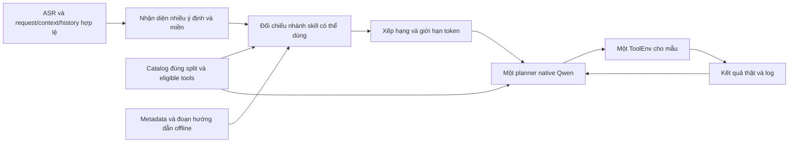

# Đề xuất retrieval skill nhẹ, offline

Ngày phân tích: 10/11/2026. Đây là thiết kế để review, **chưa triển khai**. Nguồn là [181 tool](tool-catalog-inventory.md), [17 miền](business-domains.md), [37 họ workflow](workflow-analysis.md) và [24 skill ứng viên](candidate-skills.md). Không sửa prompt, NativePlanner, KV cache, ToolEnv hoặc cấu hình trong thay đổi này.

## Kiến trúc khuyến nghị

Giữ một planner tổng quát theo [ADR 008](../adr/008-single-general-planner-for-mvp.md). Skill là hướng dẫn ngắn cho một mục tiêu hoặc nhánh nhiệm vụ, không phải agent chuyên miền, tool mới, script tự chạy hay một chuỗi tool bắt buộc. Retriever chỉ chọn hướng dẫn để planner tham khảo; planner vẫn quyết định từng call dựa trên kết quả thật của ToolEnv.

Đề xuất luồng tương lai:



Mũi tên C→G phải giữ **toàn bộ eligible tools**. Retrieval không thay thế eligibility, không xoá tool có điểm thấp, không thêm tool chỉ tồn tại ở split khác. Quy tắc nguồn: dùng đúng danh sách `context.installed_apps[app].tools` và `sys.ask_missing_info`, không mặc định mở toàn bộ tool của app. Xem [dataset.py](../../python/src/lifemate/dataset.py), [runtime.py](../../python/src/lifemate/runtime.py) và [executor.py](../../tools/test/executor.py).

## Metadata đề nghị cho mỗi nhánh skill

| Trường | Nội dung đề xuất | Vai trò |
| --- | --- | --- |
| `skill_id`, `version` | ID S01–S24, phiên bản nội dung | Định danh, tái lập và tránh chèn lặp |
| `branch_id` | Nhánh như điều khiển light, huỷ vé, checkout grocery | Không yêu cầu mọi tool của skill rộng cùng cài |
| `domain_ids` | Một hoặc nhiều D01–D17 | Giữ tín hiệu liên miền |
| `intent_keywords_vi` | Từ/cụm cùng nghĩa, có dấu và dạng chuẩn hoá | Bắt tín hiệu từ lời nói và ASR |
| `action_keywords` | Bật, tắt, sửa, huỷ, gửi, đặt, nếu… | Phân biệt hành động trên cùng đối tượng |
| `required_tools` | Tool thực sự cần ở nhánh được chọn | Kiểm nhánh có thể dùng, không phải tập hợp cả skill |
| `optional_tools` | Tool bổ sung khi cần dữ kiện/điều kiện | Tránh gọi đọc không cần thiết |
| `alternative_groups` | Các nhánh SMS/OTT, flight/train, bank/wallet | Biểu diễn lựa chọn thay vì AND toàn thư viện |
| `evidence` | JSON Pointer, split, workflow ID, mã app | Không nhận tool/đối số ngoài catalog |
| `dependency_level` | E/S/H của workflow hoặc cạnh | Chặn đưa giả thuyết chưa review vào thư viện được duyệt |
| `instruction_fragment` | Tiền điều kiện, cách lấy ID, điểm rẽ, completion và missing | Hướng dẫn ngắn theo nhánh, không chép toàn schema |
| `token_cost` | Đếm bằng tokenizer checkpoint khi đóng gói | Giới hạn overhead trước khi gọi model |
| `catalog_fingerprint` | Split, schema version, hash nội dung catalog | Phát hiện nội dung skill lỗi thời |

Đây là hợp đồng dữ liệu dự kiến, không phải file cấu hình đã tạo. `required_tools` trong [candidate-skills.md](candidate-skills.md) là hợp các nhánh để review; khi triển khai phải tách metadata nhánh, không dùng hợp đó như phép AND để vô hiệu mọi skill đa split. Nhánh có thể dùng thao tác trực tiếp nếu ID/đối số đã có từ input hợp lệ; thiếu tool đọc không nhất thiết làm thao tác đích bất khả dụng. Đánh giá các đường đáp ứng riêng, không tự bật tool đọc bị thiếu.

## Lựa chọn baseline: từ khoá, tên tool và luật nhỏ

Với 24 skill, quét tuyến tính toàn metadata đã nạp RAM là đủ cho prototype CPU; chưa có phép đo chứng minh độ trễ. Không cần vector database, external API hoặc model bổ sung.

1. Chuẩn hoá một **bản sao để tìm kiếm**: Unicode NFC, chữ thường, khoảng trắng, thêm dạng bỏ dấu. Giữ nguyên request gốc, số điện thoại, ID và đối số. Không thay toàn bộ “đặt”/“đắt” bằng một nghĩa sau bỏ dấu.
2. Lấy request ASR cuối làm tín hiệu chính. Dùng history liên quan để giải tham chiếu (“dời cái đó”, “gửi cho người ấy”), không lấy mọi call cũ thành hành động cần lặp. Context/profile/timezone hỗ trợ xác định dữ kiện, không tự tạo ý định mới.
3. Nhận nhiều nhãn miền và hành động cùng lúc. “Xem lịch rồi nhắn” kích hoạt lịch và liên lạc; “dịch rồi gửi” kích hoạt ngôn ngữ và liên lạc. “Nếu” giữ điều kiện thay vì biến thành lệnh ghi vô điều kiện. Đối chiếu enum/context khi từ khoá mơ hồ.
4. Kiểm đường tool hợp lệ của từng nhánh. Dùng tên tool được người dùng nêu rõ hoặc tool đã xuất hiện trong history liên quan làm tín hiệu bổ sung, không lấy tên của **mọi eligible tool** như bằng chứng ý định.
5. Xếp hạng từng đoạn nhánh; gộp theo skill ID, xoá đoạn trùng, chọn đủ miền liên quan trong giới hạn token. Giữ nguyên bản đầy đủ các schema native tool.

Công thức thử nghiệm ban đầu (trọng số là giả thuyết để kiểm trên Train Validation, không phải kết quả tối ưu):

```text
score(branch) = 8 * exact_tool_mention
              + 5 * specific_intent_phrase
              + 3 * matching_action_and_object
              + 2 * matching_domain
              + 1 * relevant_history_reference
              - 4 * incompatible_action
```

Các tín hiệu nên là cờ hoặc tần suất có chặn để câu dài không thắng nhờ lặp từ. Đồng hạng theo `skill_id, branch_id` cố định. Eligibility là điều kiện xét đường đáp ứng, không phải điểm thưởng áp đều. Không dùng label, tool call gold, kết quả tương lai hoặc state ẩn làm đặc trưng. Không tạo rule theo sample ID hoặc nội dung test cụ thể.

Ví dụ minh hoạ do phân tích catalog, không trích sample:

- “Huỷ vé bay đã đặt”: ưu tiên nhánh quản lý booking của S13, không chèn nhánh search/book.
- “Tắt đèn bếp”: S01/light; không chèn hướng dẫn robot, cảnh, khoá hoặc bật lịch tự động.
- “Xem lịch ngày mai rồi nhắn mẹ”: S21 + đoạn recipient SMS của S06 khi SMS hợp lệ. Calendar và contacts có thể tra theo phụ thuộc dữ liệu, không cần một thứ tự cứng nếu độc lập.
- “Dịch câu này rồi gửi vào nhóm”: S24 + đoạn chat của S06; thiếu nội dung hoặc nhóm thì dùng W36, không bịa.
- “Giá vàng hôm nay”: một tool, không cần đoạn skill chỉ để bọc tra cứu.

## Chọn nhiều miền và ngân sách

Mốc thí nghiệm: chọn 2–4 đoạn nhánh, tổng hướng dẫn khoảng **600–1.000 token**, sau khi chừa đủ toàn bộ prompt/schema/history và output trong giới hạn context thực tế (tối đa 16.384 theo brief). Đây là ngân sách dự kiến, chưa đo trên tokenizer/model thực. Không chèn cả 24 mục Markdown hay toàn bộ inventory.

Chọn theo độ bao phủ các ý định đã nhận diện: ít nhất một đoạn cho mỗi miền có mục tiêu rõ nếu còn budget, rồi thêm đoạn phân giải dữ kiện dùng chung. S21/S24 có thể đã chứa logic nguồn nội dung; chỉ chèn phần recipient của S06 một lần. S15 + S16 chỉ có một chủ sở hữu add/checkout. Tránh dùng top-1 domain hoặc top-k toàn cục làm mất nửa sau của câu nhiều mục tiêu.

Nếu không có ứng viên đáng tin hoặc chỉ là yêu cầu một tool, chèn **0 skill** và để planner dùng request/schema như hiện tại. Nếu quá budget, rút đoạn trùng/phụ trợ, rồi bỏ hướng dẫn skill ít liên quan; không bỏ eligible tools, không cắt mất kết quả thực, không nới context/output/deadline. Nếu vẫn không vừa thì giữ cơ chế lỗi/giới hạn hiện có. Hướng dẫn retrieval không được vượt giới hạn 16 bước, soft timeout 28 giây, hard timeout 30 giây trong ngữ cảnh dự án; phải chừa phần thời gian cho ASR và thực thi.

## Native Qwen và cross-step KV cache

Hiện tại [render_messages](../../python/src/lifemate/adapters/qwen_native.py) chỉ đưa `request`, `context`, `history` vào user JSON, sau đó thêm các cặp call/result thật; [tool_definitions](../../python/src/lifemate/adapters/qwen_native.py) giữ tool theo dạng native function. **Không có đường đưa skill vào prompt sẵn dùng**. Thêm một trường `skills` vào `prepared` hiện nay sẽ không tự làm model thấy hướng dẫn. Tích hợp tương lai cần thiết kế điểm nhập rõ và review riêng; báo cáo này không sửa renderer hay prompt.

Khuyến nghị cho phiên bản được phê duyệt sau:

- Chọn và đóng băng các đoạn skill một lần sau ASR, trước quyết định model đầu tiên, trong phần input guidance có cấu trúc và serialization ổn định. Không sửa mô tả/schema tool để giấu hướng dẫn. Không giả skill là kết quả từ ToolEnv hoặc native tool mới.
- Chốt thứ tự đoạn theo khóa ổn định và version. Không cập nhật thứ tự/điểm số trong phần đầu prompt sau mỗi call. Chỉ các cặp call/result **đã thực thi** được nối thêm như giao thức hiện có.
- Với [KV reuse nhánh 009](../kv-cache.md), cache chỉ dựa token prefix trùng chính xác trong mẫu, có reset/crop/fallback. Hướng dẫn đầu mẫu cố định giúp prefix ổn định; không có bảo đảm toàn prompt được reuse hoặc chạy nhanh hơn. Đổi skill giữa bước có thể giảm prefix và cần để cơ chế kiểm token hiện có xử lý, không ép dùng KV cũ.
- Baseline retrieval không chạy lại mỗi bước. Planner vẫn thấy mọi schema và kết quả để chuyển miền dù skill không được chọn. Nếu sau này cần retrieval động khi phát hiện mục tiêu mới, phải review cách thêm guidance riêng; không được giả observation hoặc ghi lại call đã có. Không chèn kế hoạch cố định vào cache để coi là đã thực hiện.
- Không dùng cache qua các mẫu. Mọi thay đổi renderer/input sẽ cần version/fingerprint mới, kiểm tương thích native grammar, SFT/runtime và không trộn artifact của phiên bản cũ. Không sửa trọng số hoặc tự đổi config trong bước nghiên cứu này.

## Matching ngữ nghĩa tuỳ chọn

Chỉ cân nhắc sau baseline: TF-IDF/BM25 trên mô tả nhánh và từ khoá tiếng Việt, word n-gram kết hợp character n-gram để chịu lỗi ASR. Đây là tìm kiếm văn bản cổ điển, có thể tính offline CPU, không thêm tham số neural. Với thư viện nhỏ, chỉ thử nếu cải thiện recall các cách diễn đạt khác nhau.

Embedding neural không phải yêu cầu của đề xuất. Nếu cân nhắc sau, phải kiểm tổng tham số ASR+LLM+embedder dưới 6B, license/nguồn được phép, file weights nằm offline và độ trễ thực; chỉ chốt sau review. Không tải model hay gọi API trong thay đổi này. Tuyên bố mô hình hiện có là PhoWhisper-large và Qwen3-4B fine-tuned đến từ ngữ cảnh nhiệm vụ, chưa kiểm snapshot weights hoặc tổng tham số thực tế.

## Kế hoạch xác minh trước triển khai

1. Duyệt metadata từng nhánh: tên tool/đối số tồn tại đúng catalog/split; nhánh khả dụng với tool subset; H chưa được duyệt thì chưa đưa vào thư viện runtime. Giữ W36 làm quy tắc thiếu dữ kiện dùng chung.
2. Chuẩn bị trường hợp diễn đạt tương đương từ catalog để kiểm retrieval, gồm phủ định, điều kiện, nhiều miền, tham chiếu history, thiếu thông tin, số điện thoại đủ rõ và tool bị thiếu. Các câu minh hoạ không phải nhãn test.
3. Đánh giá mù trên Train Validation đã đóng băng: feature retrieval chỉ lấy input hợp lệ; nhãn chỉ phục vụ chấm sau khi dự đoán đã ghi. Không thiết kế rule theo gold của từng mẫu, không nhãn hoá public/private test để tuning.
4. Khi được duyệt triển khai sau này, so sánh baseline không skill với skill được đóng băng, cùng model/config/selection. Đo quality, call dư/lỗi schema, sai ID, `done:false`, thiếu miền, tỉ lệ ask phù hợp, token hướng dẫn, CPU retrieval p50/p95, tổng độ trễ/deadline và KV reused/new tokens. Mỗi lần inference độc lập vẫn một ToolEnv cho mẫu, không reset/replay để sửa kết quả.
5. Ngưỡng kỹ thuật dự kiến để review: retrieval CPU p95 <5 ms sau nạp metadata; không cắt tool; không tăng lỗi/deadline và kiểm token-budget thực. Đây là mục tiêu, **chưa có đo latency hoặc quality**, không dùng như kết quả đạt được. Sau khi kiểm đúng mới quyết định triển khai rộng.

Chưa có implementation, benchmark hay lợi ích chất lượng/độ trễ được xác lập bởi báo cáo này.
